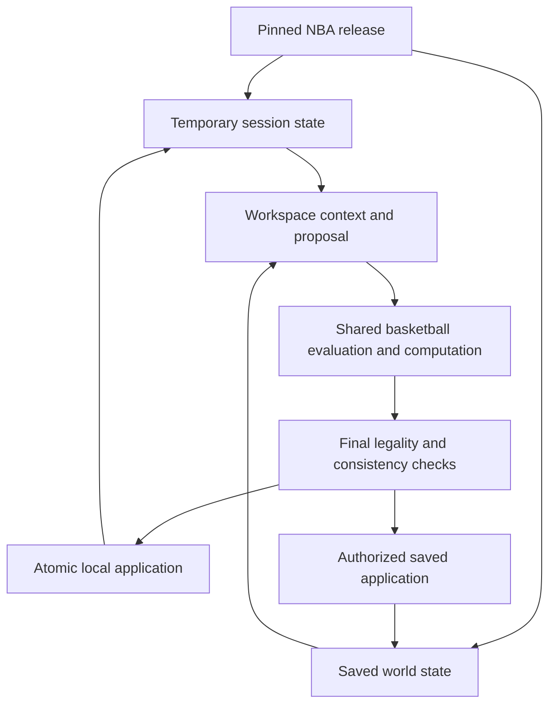

# ScoutZero Architect Core Unification Plan

## Independent plan and current owner decisions

This plan was completed before reading Claude's plan. It is preserved here for independent comparison. The only substantive changes made before that comparison apply the owner's November 28 cross-review instructions:

- Sandbox is part of Architect V1.
- Sandbox works without signing up or signing in.
- Applied Sandbox moves survive page reloads and ordinary reopening until the user deliberately presses Reset. Source updates, account changes and normal navigation must not silently discard them.
- Sandbox and Worlds use the same rules and money for the same basketball inputs.

These are settled requirements. Guest access and durable local recovery are no longer optional choices. Browser data deliberately cleared outside the app cannot be recovered without a separate backup feature; that limitation does not justify routine session expiration or silent loss. Saving the session as an account-owned World remains the separately proposed bridge described below. The original plan's engineering approach and scope are otherwise unchanged for this comparison.

# Purpose and recommendation

Build Architect around one basketball core that powers both a temporary Sandbox session and a saved world. A visitor should be able to inspect a team, construct a move, understand its legality and financial effects, apply it locally, and continue planning without creating a long-running world. Saving should preserve and extend that work.

The central requirement is **equal basketball correctness for equal inputs**. Give both modes the same starting snapshot, action date, assumptions and sequence of moves, and they must produce the same roster, Contracts, draft ownership, salary books, restrictions and verdicts. Persistence, account ownership, durable history and future progression are additional world capabilities. They must not determine which basketball rules apply.

This is a consolidation of existing working engines and a repair of incomplete entry points. It includes the data lifecycle, all promised roster-management actions, coherent temporary state, truthful UI and saved-world preservation. Rewriting the application, building another trade engine or discarding the existing world work would add risk without addressing the underlying split.

**Planning baseline:** November 28, 2026. Repository main is `04f8dde6fc1d4ad693dba5ae8c4fb6edccafd125`, including merged PRs [#690](https://github.com/Bet-Zero/scoutzero/pull/690) and [#691](https://github.com/Bet-Zero/scoutzero/pull/691). The existing completion parent is [BZE-243](https://linear.app/bzero/issue/BZE-243/architect-completion-gate-drive-v1-to-an-owner-approved-finish). This is a proposed implementation plan. Its code findings describe the inspected source; production readiness still depends on the outstanding normal-site setup and acceptance work.

# What the current project actually contains

## The product requirement has already been corrected

PR #691 makes Sandbox the primary current-snapshot experience, adds W16 and checklist S1 through S4, and requires the same basketball standard as worlds. It also removes fabricated free-agent exception defaults. PR #690 removed invented trade exceptions, corrected opening a world's season and exposed salary-loading errors. These are useful completed fixes, but they do not connect all existing Sandbox paths to the authoritative operations.

The current contract requires W2 through W10 and W14 in Sandbox as well as worlds. Full saved history, Compare and moves-so-far remain world features. Future-season progression remains post-V1. The execution plan and Linear parent still largely describe the older saved-world sequence, so their next update needs to incorporate this work rather than establish a competing project. [Current V1 contract](https://github.com/Bet-Zero/scoutzero/blob/04f8dde6fc1d4ad693dba5ae8c4fb6edccafd125/docs/agent-guides/architect-v1-completion-contract.md) · [Finish checklist](https://github.com/Bet-Zero/scoutzero/blob/04f8dde6fc1d4ad693dba5ae8c4fb6edccafd125/work/architect-completion/V1_FINISH_CHECKLIST.md) · [Execution plan](https://github.com/Bet-Zero/scoutzero/blob/04f8dde6fc1d4ad693dba5ae8c4fb6edccafd125/work/architect-completion/ARCHITECT_COMPLETION_EXECUTION_PLAN.md)

## The code is partly shared and partly split

| Area | Current source finding | Consequence for the plan |
| --- | --- | --- |
| Trade engine | Shared trade validation, execution preparation and mutation computation already exist. | Reuse them and move input resolution and application behind explicit workspace interfaces. |
| Salary treatment | Several governed salary and derived-money paths require a world ID. No-world requests can take older input paths. | Replace persistence-based decisions with complete dated transaction context. |
| Final cap validation | A preview sentinel bypasses part of the stricter current-season trade roster enforcement. Other timing, roster and cash policies also need review against the accepted rules. | Test real legality independently of mode parity. Matching an existing world result alone is insufficient. |
| Starting data | No-world team loads use shared base collections. New current-world initialization uses versioned financial and draft packages. | Provide one pinned, normalized starting release to both. |
| Older saved worlds | Some loaders fall back from a world to ancestors or mutable base team/player records. | Preserve those dependencies; updating shared base data can change an old save indirectly. |
| Temporary trade application | The no-world action reloads base teams and applies only the primary team's result. | Store the entire affected league result in a coherent session. |
| Temporary draft assets | Pick overlays use a global browser-storage key, while player changes are ephemeral. | Replace the picks-only persistence model with one complete session checkpoint policy. |
| Ordinary signing | A local signing executor exists, but the resolver selects the saved-world executor, which rejects a missing world. | Reconnect the actual shared operation instead of treating the leftover function as working support. |
| Other roster actions | Options, extensions, waivers, rights and RFA/S&T entry points or action owners require a world. | Migrate each complete action, including its inputs, legality, effects and presentation. |
| Free-agent membership | No-world and world selection use different approaches; own free agents and governed holds are also context-gated. | Build dated membership and rights from the same session state. |
| Validation freshness | Draft keys do not fully identify source release, date, state revision and all authority inputs. | A legal result must become stale whenever its decisive inputs change. |

Sources: [world and base loading](https://github.com/Bet-Zero/scoutzero/blob/04f8dde6fc1d4ad693dba5ae8c4fb6edccafd125/src/features/architect/utils/teamLoader.ts), [salary matching inputs](https://github.com/Bet-Zero/scoutzero/blob/04f8dde6fc1d4ad693dba5ae8c4fb6edccafd125/src/features/architect/utils/tradeMachine/utils/matchingValues.ts), [salary matching rule](https://github.com/Bet-Zero/scoutzero/blob/04f8dde6fc1d4ad693dba5ae8c4fb6edccafd125/src/features/architect/utils/tradeMachine/rules/validateSalaryMatching.ts), [final cap validation](https://github.com/Bet-Zero/scoutzero/blob/04f8dde6fc1d4ad693dba5ae8c4fb6edccafd125/src/features/architect/utils/capLegality/postStateCapValidator.ts), [temporary trade action](https://github.com/Bet-Zero/scoutzero/blob/04f8dde6fc1d4ad693dba5ae8c4fb6edccafd125/src/features/architect/GMDashboard/hooks/useArchitectActions.tradeActions.ts), [signing execution](https://github.com/Bet-Zero/scoutzero/blob/04f8dde6fc1d4ad693dba5ae8c4fb6edccafd125/src/features/architect/GMDashboard/hooks/useArchitectActions.signingExecution.ts), [pick overlay](https://github.com/Bet-Zero/scoutzero/blob/04f8dde6fc1d4ad693dba5ae8c4fb6edccafd125/src/features/architect/utils/entitlements/vacuumEntitlementOverlayStore.ts), [draft identity](https://github.com/Bet-Zero/scoutzero/blob/04f8dde6fc1d4ad693dba5ae8c4fb6edccafd125/src/features/architect/tradeMachine/utils/computeTradeDraftKey.ts).

This does not establish that two fully independent applications exist or that every Sandbox calculation is wrong. It establishes enough divergent inputs, gates and application paths to explain why finishing a world workflow has not reliably finished the corresponding Sandbox workflow.

## Preserve the work that is already useful

Keep the current trade preparation and execution authority, pure financial and mutation computation, normalized Contracts, cap and apron calculations, governed draft rules, immutable source package validation, trusted world initialization, saved-write protections, history and Compare improvements.

The prepared current-season baseline described in the checklist is dated November 14, 2026. It reports 30 teams, 525 roster players and 551 current/future contract records. That is evidence of an existing usable preparation pipeline, not evidence that November 28 NBA transactions are already incorporated. The first release for the unified experience must identify its actual effective date and reconcile any intervening changes. Historical draft counts and unresolved historical mappings must not be presented as the current selectable inventory. [Prepared baseline and remaining acceptance](https://github.com/Bet-Zero/scoutzero/blob/04f8dde6fc1d4ad693dba5ae8c4fb6edccafd125/work/architect-completion/V1_FINISH_CHECKLIST.md)

Normal-site initialization is also already in progress. [PR #688](https://github.com/Bet-Zero/scoutzero/pull/688) remains open at head `655def839a5f96b7effb69cb9449ee12cdc16e91`; its local checks and independent review are recorded, while deployment setup and live verification remain pending under [BZE-359](https://linear.app/bzero/issue/BZE-359). The documented setup already has owner authorization. Core consolidation can proceed alongside it. [Latest coordination](https://github.com/Bet-Zero/scoutzero/pull/688#issuecomment-7238254123)

# Product scope and behavior

## The finished current-season experience

A new temporary session starts from the latest complete maintained NBA release. It clearly shows the snapshot date, active scenario date and relevant simulation assumptions. Its tools answer what can happen in that scenario and explain missing facts or closed windows.

Applying a move updates every affected team and asset. Switching teams, rooms or the displayed salary season does not silently replace the session or discard a staged proposal. A second move uses the first move's consequences. Reset deliberately starts again from a selected current release.

A world created from the same release initially has identical books and answers. Once either workspace has different history, dates or assumptions, different results are expected and must follow those explicit differences.

Use these requirements and proposed defaults for implementation:

| Decision | Planned behavior |
| --- | --- |
| Temporary persistence | Persist the complete scenario in browser storage across reloads and ordinary reopening until Reset. Keep it separate from account-owned cloud saving; a failed checkpoint must not be reported as durably saved. |
| Source refresh | Notify that a newer release exists; retain the active session's release until the user resets or starts anew. |
| Save current work | Add a deliberate Save this session path that creates a world from the session's original release and validated actions. Keep Create fresh world distinct. |
| Dates | Separate source effective date, scenario action date and displayed salary season. Preserve the current supported same-season clock boundary. |
| Anonymous use | Sandbox works without signup or signin. Deliver the required gameplay inputs through a narrowly scoped guest-readable projection while keeping private source packages and saved worlds protected. |
| History and Compare | Keep the existing full history and comparison product in saved worlds. Local operation receipts support consistency, feedback and promotion without requiring a second full history UI. |
| Missing data | Block only the action needing the decisive fact, or use an explicitly accepted named assumption. Unknown money or availability never becomes zero or a full unused exception automatically. |

Guest access and persistence until Reset are required by the current owner direction. Save this session remains a recommended product detail; none of these statements claims that the current implementation already provides the behavior.

## Required operations

The consolidation covers reading the books; two- and three-team trades; supported current draft-asset transfers; ordinary signings; own-free-agent re-signing and renunciation; waivers, stretch and buyouts; options and extensions; offer sheets and their resolution; supported sign-and-trade; dated constraints; and Guide. Calendar-ineligible actions must still be reachable and explained correctly. Their legitimate closed-window result does not mean the feature is missing.

Preserve the deliberate V1 exclusions: nonzero trade-bonus calculations, poison-pill and performance-incentive salary bases, DPE, sign-and-trade with picks, four-team trades, draft-night UI, the Offseason room, entitlement authoring controls, raw JSON entry and certified real-life historical legality. A reachable excluded mechanism must stop honestly in both modes. The shared-core work must eliminate any legacy path that accidentally permits it. [V1 workflows and exclusions](https://github.com/Bet-Zero/scoutzero/blob/04f8dde6fc1d4ad693dba5ae8c4fb6edccafd125/docs/agent-guides/architect-v1-completion-contract.md)

# Target architecture

## One operation path with explicit context

Both workspace types supply the same normalized basketball inputs to the same action evaluation and computation. The result contains every affected team, player, Contract, entitlement, ledger and operation receipt. The destination adapter then applies that result to a temporary session or a saved world.



The common computation can remain in the existing application layer. Current basketball evaluation and much of the saved mutation pipeline run in frontend code; server initialization, account authorization and Firestore Rules provide distinct protections. Preserve canonical input reads, final action validation, saved revisions and those actual access boundaries. Moving every basketball calculation to a new server is not a prerequisite.

The common workspace context should identify:

- Workspace kind and actual scenario identity.
- Baseline release and component versions, source effective date and assumption set.
- Action date and applicable league/calendar data.
- Current state revision and proposal revision.
- Current normalized league state and prior simulated consequences.
- Rules/calculation version needed to identify a valid result.
- Persistence capabilities, separate from basketball eligibility.

Use a real temporary-session identity. Do not create fake world IDs, silently create Firestore worlds for visitors, or remove saved-world ownership checks to make local work pass. Ordinary basketball rules should consume state and history; saved-only code should handle account ownership and persistence.

## Reuse the existing boundaries

Start with `tradeContext.snapshot.ts`, `tradeExecutionAuthority.ts`, `tradeValidator.ts`, the typed mutation computation and `postStateCapValidator.ts`. Extract world-bound readers from pure decisions where necessary. Keep `mutationPipeline.persist.ts` responsible for canonical persistence, sanitation and events.

Preserve existing normalized schemas and add compatible context/version adapters rather than introducing parallel Sandbox player, Contract or entitlement models. A complete logical league state can load untouched teams lazily, as long as every team resolves against the same pinned release plus that session's overrides. Do not require every click to download all private packages.

The implementation should introduce only the interfaces needed for the first complete trade slice, then extend them through real actions. A new general platform, database or universal event-sourcing framework is unnecessary.

# Starting data and source maintenance

## Publish a complete immutable release

Introduce a small release descriptor that pins the existing financial, contract and draft artifacts together with the free-agent/rights universe, league calendar and assumptions they need. Reuse the existing digest checks and package readers. This descriptor should identify compatible components; it does not require combining everything into a giant document.

Each published release needs an immutable identifier, schema versions, component digests, source/effective dates, season, provenance and applicable assumptions. Separate when the NBA state was effective, when evidence was captured and when the release was published. None of those becomes today's date merely because the application opened.

Prepare a normalized gameplay projection containing the actual inputs required by clients. Keep raw source packages, private evidence and credentials private. Use the existing infrastructure where feasible, measure package size and reads, and choose a bounded delivery format. No new paid data provider is required by this plan.

Stage changes before activating them. Validate 30-team identity and membership, duplicate players, contract/financial consistency, current league numbers, draft ownership/obligations, source compatibility and action-specific completeness. Activate the release pointer only when its component set is coherent. Missing decisive data can remain explicitly unknown; contradictory team generations cannot become one published current release.

Existing anchors: [package reader](https://github.com/Bet-Zero/scoutzero/blob/04f8dde6fc1d4ad693dba5ae8c4fb6edccafd125/functions/src/architect/simulationPackageSource.ts), [financial package validation](https://github.com/Bet-Zero/scoutzero/blob/04f8dde6fc1d4ad693dba5ae8c4fb6edccafd125/functions/src/architect/simulationFinancialBaseline.ts), [financial normalization](https://github.com/Bet-Zero/scoutzero/blob/04f8dde6fc1d4ad693dba5ae8c4fb6edccafd125/src/features/architect/utils/simulationFinancialInputs.ts), [preparation](https://github.com/Bet-Zero/scoutzero/blob/04f8dde6fc1d4ad693dba5ae8c4fb6edccafd125/src/features/architect/utils/prepareSimulationFinancialBaseline.ts), [maintenance workflow](https://github.com/Bet-Zero/scoutzero/blob/04f8dde6fc1d4ad693dba5ae8c4fb6edccafd125/docs/operations/NBA_MAINTENANCE.md).

## Pin every dependency that can change an answer

Pin rosters and Contracts, not just team totals. Include rights and holds, exceptions and their remaining balances, hard-cap triggers, prior relevant acquisition dates, draft restrictions and claims, cash-ledger inputs and pending actions.

Free-agent membership needs particular attention: an expired contract row or a future option does not establish that a player is an available free agent on the scenario date. Resolve current membership and rights from the same snapshot and simulated changes as the roster and books. Clearly separate a future free-agent projection from a player available to sign now.

Pending offer sheets and similar operations must retain the terms, player evidence, rights, relevant release and deadline context accepted when they were created. Resolution must not unexpectedly depend on the latest mutable base-player record. Bind source evidence and reservation effects to the pending operation and validate current scenario changes separately.

Distinguish gameplay dependencies from presentation-only scouting metadata. A changed photo or scouting label need not fork a world; a changed guarantee, team assignment or option cannot silently rewrite its basketball state.

## Preserve old worlds before enabling refresh

The dangerous shortcut is updating `architect_baseTeams` and `architect_basePlayers` in place and pointing every mode at them. Existing `teamLoader.ts` fallbacks and pending-operation evidence checks make that capable of changing old saves without a world write.

Classify existing saved formats by how they resolve data: fully materialized current worlds, worlds pinned to immutable releases, older sparse worlds with ancestor/base dependencies, copies/branches and worlds with pending operations. Read representative fixtures for each existing format and preserve their current compatibility behavior.

New temporary sessions and new worlds should enroll in the new pinned release. Existing saves keep their original baseline, immutable root fields and dependency resolution. Do not reinterpret a missing old version as permission to use the latest release. Do not delete old packages while retained worlds or pending operations depend on them.

If supporting a legacy format ultimately requires materializing old dependencies, prepare a separate concrete migration with affected records, before-images, validation, retry behavior and rollback. It is not an automatic prerequisite for consolidating new workspaces.

**Release-rotation acceptance:** create local and saved scenarios from release A, make changes, create a pending offer, create a copy, then publish release B. Every A scenario and pending resolution must retain the same source meaning; newly started scenarios use B. Legacy fixtures must remain unchanged as well.

## Maintain freshness as an operational capability

Reuse the NBA maintenance workflow to collect and reconcile roster transactions, new and amended Contracts, options, waivers, exception usage, league levels, restrictions and draft changes. Give the maintenance process a documented cadence and a deliberate publish action. Begin by reconciling changes since the prepared November 14 state.

Extend the existing maintenance command or report to expose the active release, effective date, last successful preparation, incomplete inputs and failed activation. The public UI needs a clear snapshot date and actionable stale/error states. Do not promise a live NBA feed unless one is actually built and supported.

Updating a source release does not hot-rebase a user's active scenario. New source evidence may require correcting future releases; existing simulations retain their stated inputs. Separately version calculation changes, revalidate unapplied proposals when calculation behavior changes, and never silently rewrite already applied saved history.

# Temporary state and result semantics

## Treat the temporary workspace as a complete scenario

Own temporary state above the active room and selected team. Keep a single revisioned session containing the baseline reference, scenario date, changed teams and players, draft transfers and claims, contract/rights changes, exceptions, cash and hard-cap effects, pending operations and operation receipts. Untouched state may stay referenced by release.

An application result is all-or-nothing. A two-team trade cannot move the primary team's players while leaving the other team, its assets or its books unchanged. A later signing or trade must see every prior applied effect.

Replace the global `vacuum_entitlement_overlay` behavior. An old picks-only overlay has no reliable complete baseline and scenario identity; do not automatically combine it with a new roster. Use a compatibility check and a clear reset/recovery message where needed. Retire the legacy key after a deliberate transition.

Implement durable browser-local recovery as one coherent checkpoint, with format and source versions. Measure payload size before choosing IndexedDB or localStorage; sessionStorage alone does not meet persistence until Reset. Preserve the last complete valid checkpoint if a write fails, explain that the new change is not yet durably stored and allow safe retry. Define multi-tab ownership or revision conflict handling so one tab cannot overwrite another silently. On restore, preserve partial or incompatible evidence for recovery and refuse unsafe mixing with a newer release; never silently reset the session.

## Keep proposals distinct from applied actions

A draft may contain an illegal or incomplete proposal so the user can explore it. Applying requires a current authoritative result. Use a clear result contract:

| Result | Meaning | Product behavior |
| --- | --- | --- |
| Legal now | All required checks passed for the identified state, date and supported mechanism. | Allow apply and show any relevant nonblocking warnings. |
| Illegal now | A known rule, restriction or closed window prohibits the proposed action. | Block apply and explain the specific reason. |
| Needs input | A decisive fact or accepted assumption is missing. | Identify what is missing and which part of the action it affects. |
| Unavailable mechanism | The requested mechanism is outside implemented support. | Explain the limitation without suggesting that the NBA prohibits it. |
| Stale or failed | Inputs changed or evaluation could not complete. | Remove ready status, preserve the proposal and offer a safe retry. |

A planning scenario at another supported date can have different legality. Display that date and the assumptions behind it. Never present a future-conditioned proposal as executable at today's scenario date.

## Make validation freshness explicit

Bind the evaluated result to source release, workspace identity, scenario date, state revision, complete proposal and terms, applicable assumptions and rules/calculation version. Invalidate it after any decisive edit, source change, applied operation, world switch or restored state change.

Ignore late responses for an older proposal. Recheck before apply at the actual destination boundary. Saved operations must also protect against changes by another tab or writer. Exports must identify the same evaluated proposal and status rather than use a previous green result.

Review `computeTradeDraftKey.ts`, the validation hooks and argument-based caches. Prefer removing an unsafe optional cache over creating an elaborate invalidation subsystem.

## Use one honest clock model

Keep the source effective date, scenario action date, salary-view season and export-generation time separate. Use scenario time for deadlines and dated rules; use wall-clock time for operational timestamps.

Expose the supported current-season date behavior to temporary sessions. Advancing a scenario date must evaluate relevant pending deadlines and state consequences through the existing guarded logic. Changing a label alone cannot settle an offer sheet, expire an exception or cross a season. Preserve the current prohibition on unsupported season transitions and keep the existing future-season engine intact for its later integration.

The draft loader currently requires the world's scenario date to equal its baseline source date. Refactor that specific gate to preserve the immutable baseline date and digest while evaluating a supported later scenario date against applicable restrictions. Never rewrite the source date or digest to make a clock change pass. Include a forward-date draft trade in acceptance. [Existing draft loader](https://github.com/Bet-Zero/scoutzero/blob/04f8dde6fc1d4ad693dba5ae8c4fb6edccafd125/src/features/architect/utils/governedDraftWorld.load.ts)

# Implementation sequence

Use the following stages under BZE-243. They are delivery boundaries and dependency guidance, not a requirement for one large PR per stage. Split along complete operations with reviewable changes. Test saved and temporary behavior from the first migrated operation onward.

## Stage 0 Align scope and establish preservation fixtures

**Why:** the repo now promises Sandbox correctness, but the execution order, some tests and parent issue still encode the older split.

Update the existing execution plan, V1 contract where necessary, finish checklist and BZE-243 description to reflect this plan. Keep S1 through S4 and W16 as the completion anchors. Clarify which behavior-standard clauses apply to temporary sessions and which specifically require saved history. Record the owner-required guest access and persistence until Reset, and keep the proposed Save this session bridge identified separately.

Create a small set of reusable fixtures using existing packages: one untouched shared release; a changed saved world; an older sparse world; the existing copied/pending-state cases; and representative supported and blocked transactions. A currently unsupported pending-offer copy can initially prove honest refusal; successful independent copied resolution belongs to ARCH-060 and is not a prerequisite for Stage 1. Establish current saved results and preservation invariants, without treating those results as the oracle for NBA correctness.

Identify the actual callers of obsolete preview helpers and tests that hard-code world-only behavior. Do not perform a second broad repository audit before starting the first implementation slice.

**Done when:** the next actionable work is represented in the existing queue, old-save fixtures are available, supported/excluded operations are explicit, and agents can begin Stage 1 without further product reconstruction.

## Stage 1 Share the starting release and workspace context

**Why:** shared calculations cannot agree when each mode supplies different players, Contracts, dates or assumptions.

Add the minimal release/context schema and adapters. Use the existing normalized packages to produce the same beginning books, roster, rights and draft state for a new temporary session and a new world. Route the relevant team, player, free-agent and entitlement reads through explicit context. Keep old-world compatibility adapters intact.

Remove fixed placeholder dates and fresh-data fallbacks from the new context path. Separate the baseline and action dates in the governed draft loader without weakening its source digest and lineage checks. Make source errors visible. Establish the safe gameplay projection and guest access required by the owner; do not expose private packages or saved-world data incidentally.

**Main work areas:** release preparation and runtime readers; world initialization; team/player loaders; `worldTeamData`; `useArchitectPlayerData`; free-agent state; draft source baseline; normalized schemas and collection helpers.

**Done when:** starting the two workspace types from the same release produces identical normalized basketball state and book displays; source/component mismatches are refused; release A remains available after B is staged; an old saved fixture still reads identically.

## Stage 2 Complete one shared trade from proposal to applied state

**Why:** this proves the design through a useful user workflow before migrating every action.

Implement the minimal coherent temporary session and local result adapter. Connect both modes to shared trade preparation, evaluation, computed changes and final checks. Start with an ordinary supported two-team player trade, then include a supported three-team case and current draft-asset transfer. Pull forward the context and authority changes needed for each complete slice. Stage 3 finishes remaining mechanism coverage; the first slice cannot be declared complete using legacy Sandbox salary or rule shortcuts.

Replace the no-world base reload and primary-team-only mutation. Apply all affected team, asset and ledger changes atomically. Keep saved authorization and revision protection in the saved adapter. Surface the same ready/blocked/needs-input status and reasons in both modes.

Exercise a second move after the first, a team switch, a room switch and temporary refresh recovery. Preserve the existing Two-Way-only and mixed-player trade lanes, including zero matching salary where applicable, category/history limits and no invented trade exception. Zero matching salary must not bypass financial completeness or an existing hard cap. Make saved reload part of the same slice. Retire the old temporary trade application only after its actual callers are routed to the shared path.

**Done when:** identical starting context plus identical supported trades produces equal books, players, rights and restrictions across all affected teams; an invalid trade changes neither workspace; temporary refresh and saved reload preserve their complete respective results.

## Stage 3 Remove rule and authority differences

**Why:** shared execution can still carry a mode-dependent shortcut or reproduce a shared wrong verdict.

Move governed salary resolution and app-derived matching amounts behind context-based input readers. Address world-ID gates in `matchingValues.ts` and `validateSalaryMatching.ts`, the preview-world exception in final cap checks, date assumptions in roster policy and mode-bound cash/hard-cap/draft authority.

Separate trusted saved lineage from basketball facts so local scenarios can evaluate the same rules without fabricating authority. Preserve authenticated saved draft capabilities and immutable root metadata. Treat required source proof as context-bound evidence with the appropriate trust boundary.

Trace active timing, cash and roster enforcement against the accepted Canon and the supported action/date, including validators that override or bypass old global flags. Do not infer current enforcement from a flag's name alone. A warning is appropriate only when the action is permitted; a hard rule cannot become a nonblocking warning because a session is temporary. Retain actual grace periods and exceptions. Do not blanket-convert every warning to failure.

Use known expected cases from the pinned accepted Canon for both legal and illegal boundaries. Include supported BYC/aggregation mechanisms as applicable and equal honest stops for excluded bonus, poison-pill or incentive calculations. Keep the existing calendar-month aggregation implementation; do not revive an old day-count shortcut.

Complete validation identity and stale-response protection as part of this stage.

**Done when:** no supported basketball decision changes merely because a world ID is present; known rules have independently justified expected results; stale or excluded cases cannot apply through either mode. Read-only tests also prove that local operation never creates or modifies a saved world.

## Stage 4 Migrate ordinary roster and contract actions

**Why:** a correct trade machine alone would leave several promised Architect tools unusable without a world.

Migrate ordinary free-agent signing first, including its availability calculation, terms, proration, exception route, resulting Contract and roster/rights effects. Remove the misleading preview label and the resolver that unconditionally selects the world executor. Reuse existing signing calculations rather than reviving the detached local implementation as another engine.

Then migrate own-free-agent re-signing/renunciation, options, extensions, waivers, waive-and-stretch and buyouts. For each family, extract world-bound reads from existing governed decisions; preserve eligibility windows, exact financial effects and provenance. Use the proven UI entry points from the V1 contract.

Move the free-agent pool and cap-hold resolution to common dated context. Eliminate future-expiration heuristics that misclassify today's availability. Ensure signing removes a player from every relevant pool, option decisions change the proper years, renunciation clears the right hold, and waiver variants preserve the correct obligations.

**Main work areas:** `useArchitectActions.signingExecution.ts`, `useArchitectActions.contractActions.ts`, `useArchitectState.freeAgents.ts`, own-free-agent panels, governed cap-hold resolution and existing contract decision helpers.

**Done when:** every family has a legal case, a rule/window refusal and a relevant missing-input case; immediate books and all related rooms agree in both modes; saved reload preserves the result; temporary sessions can chain the action with a trade.

## Stage 5 Migrate pending and compound operations

**Why:** RFA and sign-and-trade combine teams, Contracts, deadlines, rights and several stages. They cannot be made correct by removing a world requirement from a button.

Move offer-sheet creation, reservation, matching, declining and finalization onto common context and operation results. Preserve exact deadline semantics using the accepted Canon and scenario clock. Capture creation evidence, source versions and terms so later source publication cannot invalidate an otherwise valid pending operation.

Support temporary switching between involved teams without losing the pending operation. A failed intermediate step must not leave one team with reserved money and another with an inconsistent player or rights state. Repeated submission and resolution must not duplicate effects.

Connect the Free Agency and own-FA sign-and-trade launchers to the shared transaction path. Retain the existing supported compensation scope and resulting hard-cap effects. Sign-and-trade with picks remains excluded until its separate implementation.

Keep copied-world pending-offer behavior safe. Unsupported copy cases must stop before any partial write until the existing ARCH-060 work supplies valid child authority and mirrored state.

**Done when:** match and decline cases work at lawful times in both modes, deadline failures are clear, source A to B rotation does not change pending terms, and invalid/retried compound actions never partially apply.

## Stage 6 Save a temporary session as a world

**Why:** this fulfills the intended relationship between quick planning and long-running worlds. Users should not have to rebuild their moves after choosing to save.

Add Save this session alongside the separate fresh-world creation action. Authenticate when persistence requires it. Use the selected retained release and the session's actual applied action sequence, date and assumptions. Saving promotes applied state only. A staged trade or contract proposal must never auto-apply; if retained after promotion, rebind it to the new world and revalidate it before any action.

Reuse trusted world initialization and the existing mutation boundary. Prefer initializing from the retained release and replaying validated actions through the existing canonical computation and saved-write path, with correctly translated references. A validated-materialization approach is also possible after checking the schemas and new boundary. The server must establish immutable source roots; never accept browser-supplied replacements for them. If a new server ingestion endpoint is chosen, validate its accepted input and source bindings there. This bridge does not require relocating every existing CBA calculation to the server.

Translate temporary operation identities and provenance to valid world references without losing their relationships. Preserve pending actions, all affected teams, player Contracts, draft claims, hard caps, exception balances and cash consequences. Saved history must distinguish simulated moves from opening source obligations.

Make retries safe. If initialization or later application fails, retain the temporary session, identify recovery state and avoid visible half-created worlds or duplicate successful saves. Reuse bounded initialization and existing visibility/deletion fences rather than forcing the entire league into one oversized write.

**Done when:** a session with several action families becomes a reopenable world with identical basketball state and meaningful history; interrupted attempts recover safely; fresh-world creation still works; copied and older worlds retain their own sources. Promote a valid applied scenario while an incomplete or illegal trade is staged and prove that only applied state enters the world.

## Stage 7 Finish the rooms and remove obsolete paths

**Why:** users experience the entire workflow, including explanations, navigation, exported results and blocked states.

Route Roster, Cap Sheet, Full Cap Table, Trade Machine, Free Agency, Guide and the relevant Team Plan information through the common workspace state. Reuse the shared money components and existing layout. Remove copy suggesting that accuracy requires saving a world.

Make source date, scenario date, mode, unsaved/recovery state and assumptions understandable without exposing internal schema vocabulary. A temporary session must not display a cloud-saved confirmation. World-only History/Compare should offer a sensible save/create entry point while retaining their existing product scope.

Preserve staged trades across room and team navigation. Handle reset, switching worlds and account changes explicitly. Never merge state across accounts or let a prior world's private data remain visible after sign-out. Signing in should not silently erase a temporary proposal.

Update trade exports to match the complete proposal, all participants, amounts, picks and verdict. Separate generated time from snapshot/action date and proposed from applied status. A stale validation cannot certify an export.

Remove unreachable preview helpers, duplicated financial paths, obsolete sentinels and source-shape tests only after actual callers have moved. Retain tests for no unauthorized writes, honest blocked states and preservation. Search remaining `worldId`/preview branches and classify them: persistence or identity branches may remain; basketball shortcuts may not.

**Done when:** all required rooms agree after representative chained actions; changed views pass 1280×720 and phone checks; full roster layouts retain the existing 18-player requirement; exports and status are truthful; no active required workflow reaches the retired behavior.

## Stage 8 Publish the current release and verify normal-site delivery

**Why:** source tests cannot establish that ordinary users receive the intended packages, permissions and complete working flow.

Continue BZE-359 and PR #688 using their current reviewed scope. Verify the existing authorization and operational prerequisites rather than re-requesting approval for the same documented setup. Bring additional access-policy, private-publication or migration changes for decision only when their actual scope goes beyond it.

Use the normal reviewed GitHub main to Vercel deployment process. Check deployed runtime configuration, private package isolation, applicable Rules and both History query/index shapes. Verify existing indexes before creating anything. Install or activate complete digest-verified releases; do not replace old retained releases.

Run the integrated acceptance journey on the normal site with normal accounts, including a second account for ownership isolation. Verify temporary sessions from a signed-out browser without an account, including reload recovery until Reset. Record snapshot and application version so a failure is reproducible.

Provide a rollback that can select a previously valid app/release combination for new sessions while retaining all referenced packages and user worlds. Check that any schema change remains readable by the rollback target. Keep the additive Rules deletion fence and required indexes while any deletion is unfinished; rolling back the site must not reopen writes during cleanup. Do not restore a global source pointer in a way that rewrites active scenarios. [Prepared setup and rollback](https://github.com/Bet-Zero/scoutzero/blob/655def839a5f96b7effb69cb9449ee12cdc16e91/docs/operations/ARCHITECT_WORLD_SETUP.md)

**Done when:** W16/S1–S4 and the affected existing workflows pass in the deployed product, the source rotation and saved-world preservation cases pass, and the owner can perform the final hands-on V1 acceptance.

## Work that can proceed in parallel

Normal-account setup can proceed alongside shared-core implementation. Once Stage 1 contracts and the first Stage 2 result shape are stable, ordinary contract actions and pending-operation preparation can be developed independently. UI work can follow migrated actions without waiting for every family.

A second agent can review rule expectations and preservation tests while an implementation agent works. Avoid several agents simultaneously rewriting the same action hook or schema. Integrate small complete operations and verify each against both destinations. Source rotation waits for pinning and pending-action preservation, even if the UI is ready sooner.

# Operation coverage and acceptance

This matrix defines the behavior each implementation issue must account for. A required action can correctly be unavailable at the current date; fixtures at lawful dates prove its implementation, while the current snapshot must show the correct refusal.

| Operation family | Shared result and state that must agree | Essential proof |
| --- | --- | --- |
| Starting books | Rosters, standard/Two-Way categories, Contracts, cap/tax/apron totals, holds, obligations and league levels. | Same release produces equal untouched state in all rooms; unknown final tax stays distinct from a current estimate. |
| Player trades | Governed outgoing/incoming amounts, routing, acquisition restrictions, standard/Two-Way roster categories, team books and resulting restrictions. | Two and three teams; Two-Way-only and mixed lanes; legal and illegal boundaries; a second trade uses prior changes. |
| Draft assets | Ownership, protections, swaps, fallback and connected claims, Stepien witnesses, freezes and trade horizon. | Transfer all affected claims without duplicate ownership; preserve current branch-complete rules and visible unknowns. |
| Exceptions and hard caps | Correct availability, use, creation, remainder, expiry and trigger history. | Consumed resources cannot be reused; supported trades/signings produce the same subsequent limits. |
| Cash | Both teams' dated annual ledgers and remaining authority. | Known prior usage is preserved; a decisive missing ledger cannot be silently zeroed; conservation and later transaction checks hold. |
| Ordinary signing | Eligibility, agreed terms, minimum/exception proration, roster destination, Contract and rights changes. | Supported minimum and exception routes at lawful dates; insufficient resources and closed windows refuse before apply. |
| Own free agents | Correct membership, rights, holds and re-sign/renounce effects. | A player cannot remain simultaneously available and signed; renunciation clears only the applicable rights/hold. |
| Options and extensions | Eligible families, actual dates/terms and current/future obligations. | Supported families at lawful dates; ineligible dates and missing terms explain the specific problem. |
| Waiver variants | Roster exit, guarantee/buyout amount, remaining obligations and season allocation. | Ordinary waiver, stretch and buyout preserve money; unknown stretch status is never asserted as known. |
| Offer sheets | Creation evidence, terms, deadlines, reservations and final ownership/rights. | Match and decline, missed deadline, repeated submission, source rotation and safe copied-world behavior. |
| Sign-and-trade | Signing terms, complete routing, compensation basis and resulting restrictions. | Supported no-picks cases at lawful dates; excluded combination and stale intermediate state cannot apply. |
| Scenario date | Supported forward movement and all affected dated facts. | Rewind and unsupported boundary refusal; pending operations retain valid deadlines; salary-view changes do not alter the action date. |
| Guidance and export | The same current books, restrictions, proposal and evaluated result. | Advice reflects both prior actions and uncertainty; export matches all teams and its exact status/date. |
| Saving and recovery | Complete state, source versions, operation relationships and ownership. | Local refresh, save-session promotion, saved reload, retry, stale tab, source rotation and account isolation. |

The draft-asset inventory needs a specific existing-plan follow-through: the current connected-second-round support does not establish a complete ordinary second-round portfolio. Keep ARCH-014's reconciliation and custody work visible. Similarly, current regular-season roster maximum checks do not close dated shortage/hardship requirements under ARCH-003. [Existing finding coverage](https://github.com/Bet-Zero/scoutzero/blob/04f8dde6fc1d4ad693dba5ae8c4fb6edccafd125/work/architect-completion/ARCHITECT_COMPLETION_EXECUTION_PLAN.md)

# Verification that proves correctness

## Equal results are necessary but not sufficient

Use two complementary kinds of tests.

**Parity tests** start temporary and saved contexts from identical normalized inputs and apply the same proposals. Compare all meaningful basketball outputs and relationships, including every affected team and ledger, rather than only the green/red verdict. Normalize legitimate generated-identity differences through a checked one-to-one mapping and verify every Contract, offer, entitlement, ledger and event reference under that mapping. Ignore only storage metadata and operational timestamps that have no basketball or integrity meaning; economic dates remain part of the comparison.

**Independent expected-result tests** establish legality and money from the accepted Canon and known fixture facts. Both modes can agree on a wrong result. Check calculation boundaries, transaction dates, prior simulated history, exceptions and unsupported mechanisms against explicit expected values or outcomes.

The accepted rulebook is Canon v2.0 at `6cf8aaf358c158a88e630e8a7336f7e9c3febc17`, accessed using the existing lookup command. The file with the same name currently on main is a rejected historical version; do not use it as the rule authority. Recheck the pin through the repository lookup when implementation begins. [Canon instructions](https://github.com/Bet-Zero/scoutzero/blob/04f8dde6fc1d4ad693dba5ae8c4fb6edccafd125/docs/reference/cba/README.md)

## Required scenario groups

1. **Starting equality:** all 30 teams, current Contracts and roster categories, books, available resources and draft state agree for the same release.
2. **Supported transactions:** representative legal and illegal cases for each required family, including interactions across families.
3. **Boundaries:** relevant roster counts, matching/apron limits, acquisition timing, deadlines, exception balances, entitlement claims and available cash.
4. **Chained actions:** trade then sign; waive then sign; consume an exception then attempt reuse; transfer a draft right then attempt a conflicting transfer.
5. **Dated behavior:** lawful fixture dates, closed-window results, date edits, season-view edits, pending deadlines and supported forward movement.
6. **Uncertainty and exclusions:** decisive unknown versus actual zero, accepted named assumptions, known restrictions, and the same honest stop for excluded mechanisms.
7. **Freshness:** edit terms after evaluation, change selected route or affected state, receive an older async result, switch worlds, restore a session and attempt stale apply/export.
8. **Atomicity and retry:** duplicate click, interrupted response, repeated request, stale saved revision and multi-team failure. Verify no duplicated or partially applied consequences.
9. **Source rotation:** release A sessions, worlds, copies and pending offers remain stable after B becomes current; new sessions and worlds use B.
10. **Saved preservation:** representative legacy and current formats, immutable roots, pending actions, copied worlds, deletion/recovery fences and ownership boundaries.
11. **Product journey:** normal entry points, navigation retention, full roster layouts, all affected rooms, accurate export, temporary recovery and saved reload.
12. **Deployed access:** required guest use without signup, normal world creation, two-account isolation, private package protection and the installed runtime/index paths.

Complete missing current-roster shortage/hardship legality and the rare-event input compiler defect tracked in ARCH-063 as focused correctness work. The compiler must accept complete supported combinations without erasing obligations; missing-input behavior must remain honest. These are existing completion findings, not reasons to invent a new broad certification program.

## Proportionate engineering checks

Follow the current AGENTS requirements for the changed area. Use focused tests while developing, then `npm run test:diff -- --reporter=dot` for the change. Add type checking and a build when types or application output change; run relevant Functions tests for runtime work. Use one integrated final battery when the connected workflow is ready. Do not repeatedly run the whole suite or demand a browser certificate for every small PR.

Money, rule, saved-state, authorization and source-acceptance changes require independent review of the actual diff and expected outcomes. UI copy-only work does not need financial test machinery. If an existing test encodes the obsolete world-only promise, change that promise explicitly and preserve its underlying safety guarantee instead of deleting inconvenient failures.

A changed action is finished when it produces correct visible results, blocks correctly, preserves drafts, updates all related rooms, and survives the appropriate temporary recovery or saved reload. Saved History/Compare verification applies where those features are part of that action. Document reusable evidence in the existing PR/issue/checklist, not a new parallel reporting system. [Development and review rules](https://github.com/Bet-Zero/scoutzero/blob/04f8dde6fc1d4ad693dba5ae8c4fb6edccafd125/AGENTS.md)

# Saved state and security requirements

Preserve ownership checks, authenticated runtime identity, private source access, schema validation, immutable source roots, canonical write sanitation, transaction/revision checks and deletion fences. Keep authorization separate from the shared math.

The existing saved paths have different retry protections. Draft operations already use deterministic operation identities and transactional rereads in relevant paths; ordinary operation IDs are not universally idempotent. Verify each touched action's actual behavior rather than claiming that the whole pipeline already guarantees safe retries. Add the minimum request identity and result recovery needed for repeated requests and response loss.

Saved application must validate against the current saved revision. Local application must validate against its current session revision. Both must enforce the same basketball consistency: no duplicate player membership, impossible draft custody, double-spent exception or conflicting entitlement claim. Database lookup and locking implementations may legitimately differ.

Account changes must clear access to private saved data and prevent accidental cross-account reuse. Preserve temporary work where safe without attaching it to an account or world implicitly. Decide how multiple tabs are isolated for local sessions and how concurrent saved writers are rejected or refreshed.

Source retention, package size, write bounds and recovery costs should follow actual usage and existing limits. Measure the new projection and a representative multi-action session. Address a demonstrated limit with bounded chunks, lazy reads or existing storage tools. Do not introduce arbitrary user caps or paid infrastructure preemptively.

# Integration with the existing execution plan

The V1 finish checklist remains the status home. Add the consolidation sequence to the existing execution plan and create or amend BZE-243 child issues for concrete outcomes. Link each to S1 through S4, W16 and the existing findings it closes. Do not mark a family complete merely because its schema or shared helper exists.

Keep already merged improvements, including dated ordinary signings, derived trade money, tax labeling, signed space, history attribution, Guide limits and exception/Compare changes. Correct the stale queue wording for BZE-366, whose Compare pagination work has merged in [#689](https://github.com/Bet-Zero/scoutzero/pull/689).

The following reconciliation retains every existing ARCH finding:

| Existing findings | Treatment in this plan |
| --- | --- |
| ARCH-001–002 | Preserve restored main and delivery work; align live pointers, parent issue and queue in Stage 0 and Stage 8. |
| ARCH-003–007 | Extend dated roster, clock, signing, derived trade money and per-action readiness into common context during Stages 1–4; finish the remaining dated legality cases. |
| ARCH-008–013 | Reuse current tax distinctions; complete action-critical rights/options/extensions and pin/correct the free-agent universe through Stages 1, 4 and 5. |
| ARCH-014–017 | Complete ordinary second-round coverage and preserve connected claims; retain and extend saved draft/exception receipts and Compare pagination through Stages 2, 3 and 7. |
| ARCH-018–021 | Preserve opening-obligation attribution, stretch uncertainty, Guide policy and signed money displays; make their shared data sources consistent in Stage 7. |
| ARCH-022–026 | Finish feedback, dialogs, draft retention, export and integrated acceptance; extend the old W1–W15 coverage to W16 in Stages 2–8. |
| ARCH-027–035 | Carry atomicity, retry, branches, legacy preservation, versioning, runtime, ownership, measured capacity, independent review and owner acceptance throughout the relevant stages. |
| ARCH-036–041 | Retain the future-season sequence described below; current-season consolidation supplies its common state and operation foundations. |
| ARCH-042–046 | Retain later incentives, bonuses, poison-pill, DPE and richer contract-authoring work; preserve current exclusions until each is explicitly implemented. |
| ARCH-047–052 | Retain proposed Two-Way conversion, Ten-Day/rest-of-season, second-round signing, renegotiation, waiver claims and selected operational/medical depth. Necessary present-day legality state remains part of the current core. |
| ARCH-053–057 | Keep conditional cash and optional four-team, Offseason, draft-night and authoring breadth explicit. No silent expansion of the current contract. |
| ARCH-058–059 | Preserve transparent simulation assumptions and the boundary around adjacent scouting tools, new providers, generic redesign and platform rewrites. |
| ARCH-060–061 | Complete copied pending-offer safety and source-pinned resolution in Stage 5 before enabling source rotation involving those dependencies. |
| ARCH-062–063 | Resolve current dated cash inputs/allowed assumptions and complete rare-event combinations in Stage 3 and the associated data work; annual rollover follows future progression. |

An initial issue sequence can follow the stage outcomes: shared baseline/context; coherent temporary trade execution; rule/authority parity; ordinary action families; pending operations; session saving; room/export cleanup; normal-site acceptance. Reuse or extend an existing open issue where it already owns the exact outcome. Do not create duplicate issues for work that has merged.

# Future season work after the current core

Keep the current-season repair finite. Then continue the existing full-Architect proposal using the same engine and workspace model. The unresolved owner choices are the supported future horizon, how projected league figures are selected and labeled, and optional product breadth. Those choices do not block the current core.

## Future stage 1 Establish future authority and transition seams

Select a finite horizon and projection policy. Version future calendar and league levels, preserve known actual inputs and label projections. Reuse the existing 30-team Season Advance engine; connect it to shared state and operations rather than creating world-only math again.

Define transitions for contracts, rights/holds, option windows, exceptions, hard caps, cash years, pending operations and draft obligations. Partial advancement must not leave teams in different seasons.

## Future stage 2 Settle drafts and carry Contracts

Resolve protected, pooled, swap and frozen rights from simulated outcomes while preserving all counterparties and lineage. Connect selections to rookie rights and signed/unsigned outcomes. Extend structured contract authoring and provenance so an authored Contract can be signed, advanced, amended, traded and waived without fabricated source evidence.

Complete ordinary first/second-round portfolio coverage and the required signing routes. Financial and draft transitions must compose across the full league.

## Future stage 3 Add the selected advanced mechanisms

Implement incentives, nonzero trade bonuses, poison-pill treatment, DPE and sign-and-trade with picks in their dependency order. Each needs its own dated inputs, calculations and tests before removing the current stop. Then add selected Two-Way conversion, Ten-Day/rest-of-season, renegotiation, claims/set-off and operational/medical depth.

Keep four-team trades, a guided Offseason room, interactive draft night and custom asset authoring as explicit product choices. UI additions should connect to already working common operations.

## Future stage 4 Prove long-running worlds

Demonstrate at least two consecutive complete annual transitions across all 30 teams, including branches, pending actions, source versions, saved reload and rollback/recovery behavior. A single team's changed season label is not progression proof.

Temporary scenarios can later expose supported future planning if selected, using the same rules and explicit assumptions. Durable multi-season history and account-owned branching remain additional world value. This sequence preserves the reason worlds exist while keeping accurate current-season planning independently useful.

# Agent implementation map

These are the primary existing seams to change or preserve. Names refer to the inspected repository, not a requirement to create new parallel modules.

| Area | Existing implementation anchors | Intended change |
| --- | --- | --- |
| Release preparation | [simulationFinancialInputs](https://github.com/Bet-Zero/scoutzero/blob/04f8dde6fc1d4ad693dba5ae8c4fb6edccafd125/src/features/architect/utils/simulationFinancialInputs.ts), [prepareSimulationFinancialBaseline](https://github.com/Bet-Zero/scoutzero/blob/04f8dde6fc1d4ad693dba5ae8c4fb6edccafd125/src/features/architect/utils/prepareSimulationFinancialBaseline.ts), [runtime package source](https://github.com/Bet-Zero/scoutzero/blob/04f8dde6fc1d4ad693dba5ae8c4fb6edccafd125/functions/src/architect/simulationPackageSource.ts) | Compose versioned compatible releases and a safe gameplay projection from existing artifacts. |
| Team and player reads | [teamLoader](https://github.com/Bet-Zero/scoutzero/blob/04f8dde6fc1d4ad693dba5ae8c4fb6edccafd125/src/features/architect/utils/teamLoader.ts), [player subscription](https://github.com/Bet-Zero/scoutzero/blob/04f8dde6fc1d4ad693dba5ae8c4fb6edccafd125/src/features/architect/utils/subscribeArchitectPlayerData.ts), [player hook](https://github.com/Bet-Zero/scoutzero/blob/04f8dde6fc1d4ad693dba5ae8c4fb6edccafd125/src/features/architect/hooks/useArchitectPlayerData.ts) | Resolve new contexts from their pinned release and scenario overrides; preserve legacy adapters. |
| Trade preparation | [trade context snapshot](https://github.com/Bet-Zero/scoutzero/blob/04f8dde6fc1d4ad693dba5ae8c4fb6edccafd125/src/features/architect/utils/tradeContext/tradeContext.snapshot.ts), [execution authority](https://github.com/Bet-Zero/scoutzero/blob/04f8dde6fc1d4ad693dba5ae8c4fb6edccafd125/src/features/architect/utils/tradeContext/tradeExecutionAuthority.ts) | Expose common context-driven preparation, computed effects and final execution decisions. |
| Salary and roster rules | [matchingValues](https://github.com/Bet-Zero/scoutzero/blob/04f8dde6fc1d4ad693dba5ae8c4fb6edccafd125/src/features/architect/utils/tradeMachine/utils/matchingValues.ts), [validateSalaryMatching](https://github.com/Bet-Zero/scoutzero/blob/04f8dde6fc1d4ad693dba5ae8c4fb6edccafd125/src/features/architect/utils/tradeMachine/rules/validateSalaryMatching.ts), [validateRoster](https://github.com/Bet-Zero/scoutzero/blob/04f8dde6fc1d4ad693dba5ae8c4fb6edccafd125/src/features/architect/utils/tradeMachine/rules/validateRoster.ts), [validation flags](https://github.com/Bet-Zero/scoutzero/blob/04f8dde6fc1d4ad693dba5ae8c4fb6edccafd125/src/config/validationFlags.ts) | Remove persistence-conditioned rules; justify warn/fail boundaries using the accepted Canon. |
| Final legality and writes | [postStateCapValidator](https://github.com/Bet-Zero/scoutzero/blob/04f8dde6fc1d4ad693dba5ae8c4fb6edccafd125/src/features/architect/utils/capLegality/postStateCapValidator.ts), [mutation pipeline](https://github.com/Bet-Zero/scoutzero/blob/04f8dde6fc1d4ad693dba5ae8c4fb6edccafd125/src/features/architect/utils/mutationPipeline.ts), [persistence](https://github.com/Bet-Zero/scoutzero/blob/04f8dde6fc1d4ad693dba5ae8c4fb6edccafd125/src/features/architect/utils/mutationPipeline.persist.ts) | Share basketball invariants while retaining trusted saved reads, authorization, revision checks and canonical writes. |
| Draft data and local overlays | [draft source baseline](https://github.com/Bet-Zero/scoutzero/blob/04f8dde6fc1d4ad693dba5ae8c4fb6edccafd125/src/features/architect/utils/entitlements/draftSourceBaseline.ts), [entitlement resolver](https://github.com/Bet-Zero/scoutzero/blob/04f8dde6fc1d4ad693dba5ae8c4fb6edccafd125/src/features/architect/utils/entitlements/entitlementResolver.ts), [temporary overlay store](https://github.com/Bet-Zero/scoutzero/blob/04f8dde6fc1d4ad693dba5ae8c4fb6edccafd125/src/features/architect/utils/entitlements/vacuumEntitlementOverlayStore.ts) | Bind custody and evidence to the scenario; replace global picks-only storage without changing legacy source meaning. |
| Trade state and freshness | [trade actions](https://github.com/Bet-Zero/scoutzero/blob/04f8dde6fc1d4ad693dba5ae8c4fb6edccafd125/src/features/architect/GMDashboard/hooks/useArchitectActions.tradeActions.ts), [validation hook](https://github.com/Bet-Zero/scoutzero/blob/04f8dde6fc1d4ad693dba5ae8c4fb6edccafd125/src/features/architect/hooks/useTradeMachineValidation.ts), [draft key](https://github.com/Bet-Zero/scoutzero/blob/04f8dde6fc1d4ad693dba5ae8c4fb6edccafd125/src/features/architect/tradeMachine/utils/computeTradeDraftKey.ts) | Apply every affected result, preserve drafts and reject stale validation/apply. |
| Ordinary action dispatch | [signing execution](https://github.com/Bet-Zero/scoutzero/blob/04f8dde6fc1d4ad693dba5ae8c4fb6edccafd125/src/features/architect/GMDashboard/hooks/useArchitectActions.signingExecution.ts), [contract actions](https://github.com/Bet-Zero/scoutzero/blob/04f8dde6fc1d4ad693dba5ae8c4fb6edccafd125/src/features/architect/GMDashboard/hooks/useArchitectActions.contractActions.ts) | Route temporary and saved actions into shared governed decisions and destination adapters. |
| Free agents and pending actions | [free-agent state](https://github.com/Bet-Zero/scoutzero/blob/04f8dde6fc1d4ad693dba5ae8c4fb6edccafd125/src/features/architect/GMDashboard/hooks/useArchitectState.freeAgents.ts), [offer-sheet actions](https://github.com/Bet-Zero/scoutzero/blob/04f8dde6fc1d4ad693dba5ae8c4fb6edccafd125/src/features/architect/GMDashboard/hooks/useArchitectActions.offerSheetActions.ts) | Use dated membership, pinned terms and complete pending-operation state. |
| Workspace and export | [GMDashboard](https://github.com/Bet-Zero/scoutzero/blob/04f8dde6fc1d4ad693dba5ae8c4fb6edccafd125/src/features/architect/GMDashboard/GMDashboard.tsx), [TradeEditor](https://github.com/Bet-Zero/scoutzero/blob/04f8dde6fc1d4ad693dba5ae8c4fb6edccafd125/src/features/architect/tradeMachine/TradeEditor.tsx), [TradeExportCapture](https://github.com/Bet-Zero/scoutzero/blob/04f8dde6fc1d4ad693dba5ae8c4fb6edccafd125/src/features/architect/tradeMachine/TradeExportCapture.tsx) | Consume shared session state and show accurate dates, status, recovery and complete proposal results. |
| Nontrade dispatch and dates | [action owners](https://github.com/Bet-Zero/scoutzero/blob/04f8dde6fc1d4ad693dba5ae8c4fb6edccafd125/src/features/architect/GMDashboard/hooks/useArchitectActions.ts), [workspace context](https://github.com/Bet-Zero/scoutzero/blob/04f8dde6fc1d4ad693dba5ae8c4fb6edccafd125/src/features/architect/GMDashboard/hooks/useArchitectWorkspaceContext.ts), [time controls](https://github.com/Bet-Zero/scoutzero/blob/04f8dde6fc1d4ad693dba5ae8c4fb6edccafd125/src/features/architect/GMDashboard/components/WorldTimeControls.tsx) | Connect actual launchers and modal/action owners; supply an action date in both modes separately from the viewed season. |
| Own assets and Guide | [swap assets](https://github.com/Bet-Zero/scoutzero/blob/04f8dde6fc1d4ad693dba5ae8c4fb6edccafd125/src/features/architect/GMDashboard/hooks/useSwapAssets.ts), [Guide roster policy](https://github.com/Bet-Zero/scoutzero/blob/04f8dde6fc1d4ad693dba5ae8c4fb6edccafd125/src/features/architect/guidedQuestions/guideRosterPolicy.ts), [own free agents](https://github.com/Bet-Zero/scoutzero/blob/04f8dde6fc1d4ad693dba5ae8c4fb6edccafd125/src/features/architect/utils/ownFreeAgents.ts), [cap-hold resolution](https://github.com/Bet-Zero/scoutzero/blob/04f8dde6fc1d4ad693dba5ae8c4fb6edccafd125/src/features/architect/capSheet/CapSheetFull/useGovernedCapHoldResolution.ts) | Read draft assets, own-FA membership, holds and guidance from complete session context. |
| Navigation and save status | [save state](https://github.com/Bet-Zero/scoutzero/blob/04f8dde6fc1d4ad693dba5ae8c4fb6edccafd125/src/features/architect/GMDashboard/hooks/teamPlanSaveState.ts), [desk navigation](https://github.com/Bet-Zero/scoutzero/blob/04f8dde6fc1d4ad693dba5ae8c4fb6edccafd125/src/features/architect/GMDashboard/hooks/useArchitectDeskNavigation.ts) | Preserve unapplied drafts and context transitions; distinguish temporary recovery from an actual saved-world write. |
| Source contracts and access | [Architect schema reference](https://github.com/Bet-Zero/scoutzero/blob/04f8dde6fc1d4ad693dba5ae8c4fb6edccafd125/docs/reference/schema/architect.md), [collection constants](https://github.com/Bet-Zero/scoutzero/blob/04f8dde6fc1d4ad693dba5ae8c4fb6edccafd125/src/constants/collections.ts), [Firestore Rules](https://github.com/Bet-Zero/scoutzero/blob/04f8dde6fc1d4ad693dba5ae8c4fb6edccafd125/firestore.rules) | Keep compatible schemas and approved access boundaries; scope new projections separately from private packages. |
| Product and coordination | [V1 contract](https://github.com/Bet-Zero/scoutzero/blob/04f8dde6fc1d4ad693dba5ae8c4fb6edccafd125/docs/agent-guides/architect-v1-completion-contract.md), [execution plan](https://github.com/Bet-Zero/scoutzero/blob/04f8dde6fc1d4ad693dba5ae8c4fb6edccafd125/work/architect-completion/ARCHITECT_COMPLETION_EXECUTION_PLAN.md), [finish checklist](https://github.com/Bet-Zero/scoutzero/blob/04f8dde6fc1d4ad693dba5ae8c4fb6edccafd125/work/architect-completion/V1_FINISH_CHECKLIST.md) | Maintain one scope, work order and completion record. |

# Decisions and remaining evidence

The implementation should proceed using the proposed defaults above. These are the limited matters that could change scope or require a concrete owner decision:

| Matter | Recommended handling |
| --- | --- |
| Guest access to the current trade machine | Settled requirement: no signup or signin. Implement a narrowly scoped gameplay projection. Deployment still follows the applicable operational authorization; the product decision needs no further approval. |
| Temporary recovery and promotion | Persistence across reloads and ordinary reopening until Reset is required. Save this session remains a proposed bridge. Do not add full local History/Compare, cross-device sync, sharing or undo/redo as incidental requirements. |
| Live source freshness | Determine the latest actually prepared and installed release during delivery. Reconcile since November 14 and display the true date; do not infer freshness from deployment time. |
| Legacy dependency coverage | Resolve through representative stored formats and fixtures. Escalate only an actual required data migration, with a prepared concrete change and preservation evidence. |
| Shared deployment setup | Reuse existing BZE-359 approval for its documented scope. Additional publication/access/migration changes need their own applicable authorization, not a repeated blanket approval request. |
| Future simulator breadth | Decide horizon, projection policy and optional mechanisms at the future phase. Preserve current exclusions until then. |

The main engineering risks are incomplete input pinning, incomplete multi-team results, shared but incorrect rules, stale legal results and accidental changes to older saves. The release/context model, complete-result adapter and targeted acceptance cases above address those risks directly.

The first useful milestone is a fresh temporary session and a fresh world from one pinned release that can perform the same ordinary trade, then a second move, with equal complete state. The next milestones expand that proven path across the required action families. Production acceptance comes after those integrated flows work, not after documentation alone changes.

# Initial agent handoff

Use this brief to start implementation after assigning the corresponding work under BZE-243. The first agent owns a small executable slice and carries the existing preservation requirements through it.

```text
Project: ScoutZero, Bet-Zero/scoutzero, default branch main.

Goal:
Make Architect's temporary session and saved worlds use one accurate basketball
core. Equal baseline, date, assumptions and actions must give equal basketball
state and verdicts. Save ownership and persistence remain separate capabilities.

Start:
1. Read current AGENTS.md and the existing V1 contract, execution plan and finish
   checklist. Fetch current main and inspect only relevant changes since this
   plan's baseline 04f8dde6fc1d4ad693dba5ae8c4fb6edccafd125.
2. Reconcile this work into BZE-243 and S1-S4/W16 without reopening merged work or
   starting another status system.
3. Implement the smallest shared release/context and temporary-state slice that
   supports one complete ordinary two-team trade through the existing engines.
4. Apply the entire affected result locally; retain the existing trusted saved
   path. Prove a second move, team/room switching, temporary recovery and saved
   reload. Add representative three-team and draft-asset cases as the slice grows.
5. Check expected legality independently using the accepted Canon lookup.
   Parity with existing world output alone is insufficient.
6. Preserve legacy loaders and source dependencies. Do not refresh mutable base
   collections, migrate old worlds or expose private packages as a shortcut.
7. Update focused tests and obtain independent review for money/rules/saving or
   source-acceptance changes. Follow normal repository PR and delivery rules.
8. Report actual changed behavior, remaining action families and concrete
   blockers. Continue the next authorized implementation slice without another
   broad investigation.

Sandbox is V1, needs no signup, and its applied moves persist locally until Reset.
Keep the existing UI layout and current V1 exclusions. Do not add fake world IDs,
silent saved worlds, a second financial engine or blanket warning downgrades.
Do not perform new production/data/access changes beyond their existing
authorization. BZE-359 setup can proceed independently in its approved scope.
```
